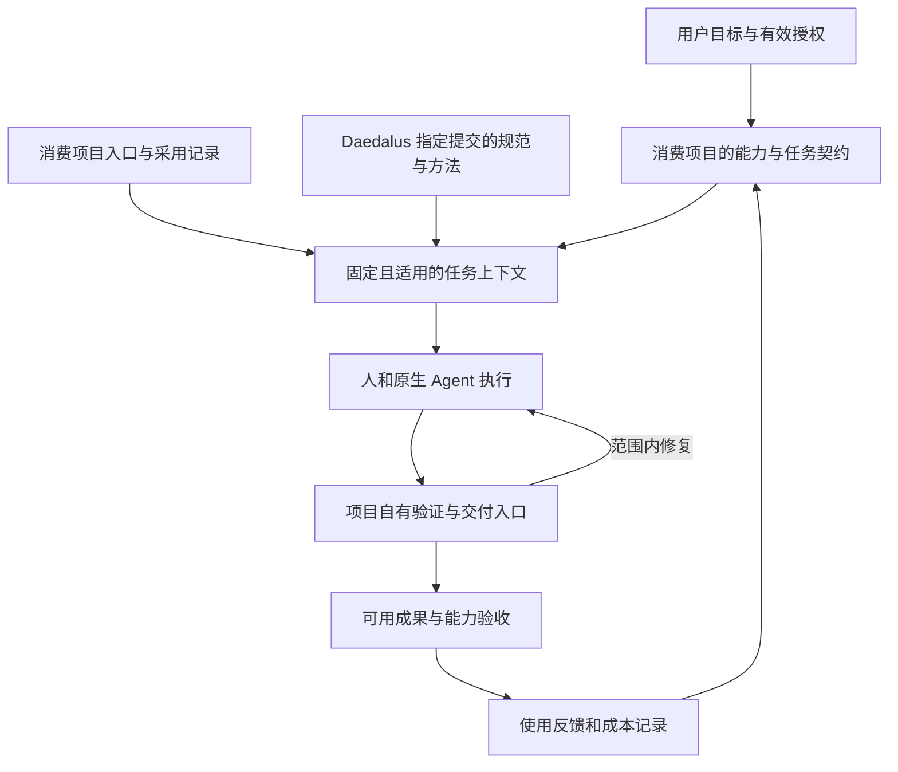

# 消费项目接入与 G2 准备方案

状态：**Proposed**，2026-10-26。范围是消费使用路径、候选任务与 G2 绑定准备；尚未冻结切片契约或开展 G2 裁决，不授权消费者实现、采用迁移、线上 CI / Ruleset 修改或发布。

建议保留 Daedalus 的完整 Engineering Delivery System 定位，首种使用形态是消费项目可以显式采用的工程交付套件：项目入口、固定规则、方法和结果关联共同工作。先用原生 Agent 与仓库现有工具形成使用基线，再依据实际协调成本决定是否增加程序或服务。套件不是新的架构层，也不把阶段 A 缩减为安装工具或阅读规范。

本方案依据维护者提供的消费路径建议及 `main@5e3c2a6c69d9bae31463ea2ee28fb61aea8e0e34`，衔接[产品契约](../product.md)、[Architecture v0](../architecture.md) §5–8 和[工程约定](../engineering.md)。以下项目状态是本次准备快照，不能代替执行前重新核对；正式绑定、评审、采用与运行记录进入 [G2 工作项 #3](https://github.com/snkio027/daedalus/issues/3) 及其后续交付记录。

## 1. 消费入口与责任

| 工作场景 | 入口与责任 |
| --- | --- |
| 开发 Daedalus | 根 `AGENTS.md` 导航到本项目的产品、架构与工程约定 |
| 在已接入项目完成任务 | 从消费项目入口读取其契约、采用记录、本次任务和真实工程入口 |
| 初次接入 | 核对现状，提出采用范围、固定版本、例外与接入验证，再由消费项目作出采用决定 |

消费项目不继承 Daedalus 自身“尚无控制面运行能力、仅有文档维护检查”的事实，也不默认执行本仓库所有 Proposed 建议。一个仓库同时保存已采用规范、历史版本和候选方法，不表示它们对每个消费者都有效。

入口负责导航，原规范保留完整条件，项目继续维护构建、验证、发布和权限。读取成功仅证明内容被取得；不能证明指令被遵守、门禁已启用或能力已接受。

当前消费目录入口见[共享内容目录](../standards/README.md#消费项目怎样采用)。本方案保留准备快照与实验选项，不另行发布已验证的接入手册。下表的历史提交、路径和摘要保持原身份；当前 Agent 候选已独立到 [agent-workflow.md](../agent-workflow.md)，不将新路径静默套用到旧提交。

## 2. 第一条消费路径

首轮建议采用**项目入口＋固定规范副本＋现有工程入口＋一份任务记录**。无需先建设 CLI、MCP、数据库、插件或常驻协调器。

1. **核对现场。** 记录消费仓库的实际分支、提交、未提交修改、现有执行者与外部操作。既有工作不归入新任务，也不为接入清空工作区。
2. **提出采用记录。** 在消费项目既有工程说明中记录来源仓库、完整提交、路径、SHA-256、章节范围、规范状态、项目差异、验证入口及采用责任。没有现成位置时可用一份 Markdown，不要求每种对象独立建文件。
3. **取得固定内容。** 建议首轮把所选文件按原始字节随消费仓库版本管理；索引另记出处与摘要，避免维护第二份改写正文。更新须通过消费项目变更流程。下载失败、摘要不符或必需来源缺失时停止相关操作，不回退到 main/latest。
4. **更新短入口。** 指向采用记录、相关项目契约、任务位置和验证入口。读取跨用途文件时明确采用章节；不复制 Daedalus 根 `AGENTS.md`，也不将其他章节自动升级为消费项目要求。
5. **形成任务上下文。** 固定 Capability / Task revision、代码基线、适用规则、环境、权限与预算。插件版本、Agent 版本和已采用规则版本分别记录，工具升级不自动迁移规则。
6. **执行和核对。** 调用项目已有入口，在范围内修复；候选变更、实际受测对象、集成提交、交付物、验收与反馈逐项关联。中断后核对所有权、现场和未知操作再接手，不能仅复述聊天摘要。

首次采用清单可从以下对象选择，尚不是消费项目的批准记录：

| 对象 | 可固定的来源与状态 | 首轮处理 |
| --- | --- | --- |
| Git/GitHub v1.1 | `snkio027/daedalus@f06cb76ff2d216f31f90f4e9a27f6af732104d37`，`docs/standards/git-github-workflow/v1.1.md`；SHA-256 `de77bfd55da3811ed553985db8d61938467a2a3b2c0215e225b607428b667a86`；Daedalus 已采用 | 消费者另行评审自身 Instance；PR-full / Queue 与 standard / assured 分别选择，不因引用而改变实际保护 |
| Agent Engineering Workflow | `5e3c2a6c69d9bae31463ea2ee28fb61aea8e0e34` 中 `docs/engineering.md#agent-engineering-workflow`；完整文件 SHA-256 `1a5efb15f2beb05a8bc4945af460034afa99ea19da22c01b1f653fda64955d39` | Proposed，仅将选定方法作为试验输入；完整文件校验与章节适用范围分开，Daedalus 自身 Profile 不随之继承 |
| 供应链指南 r2 | 同一 `5e3c2a6` 提交中的 `docs/standards/software-supply-chain-security/2026-edition-draft.md`；摘要见[工程规范索引](../standards/README.md)及来源记录 | Proposed，按真实制品、发布和信任需求选择；不把全部云平台控制强加给首轮 |
| 数据建模指南 | [PR #7](https://github.com/snkio027/daedalus/pull/7) 的候选 | 待评审，不作为本方案的依赖，也不继承为已采用规则 |

正式接入要以完整提交和实际字节重新核对上述身份；版本名或章节摘要本身不能建立信任。已接受的项目契约与候选方法有冲突时，候选方法不覆盖契约；任何例外或契约变更单独记录。

### 接入演练的验收规格

下列均为待执行规格。演练通过只证明接入路径成立，不算阶段 A 完成。

| 场景 | 必须得到的结果 |
| --- | --- |
| 在目标仓库启动任务 | 找到正确采用记录、固定内容和项目检查入口，没有套用 Daedalus 自身环境事实 |
| 必需副本缺失、摘要不符、改为 latest | 明确受阻；不得悄悄换版本或省略规则 |
| Proposed 方法与已接受契约冲突 | 显示冲突与责任，不将候选建议当作更高权威 |
| 候选修改之后复用旧验证 | 核对实际对象与适用性；旧绿灯不自动放行新候选 |
| 旧执行器失联、存在未决外部操作 | 核对或可靠撤销写权，先处理未知副作用，不产生第二写入者 |
| 插件或方法包升级 | 已采用规则保持固定；迁移单独产生可审查变更 |

Codex 官方说明指令发现按全局及项目目录链进行；消费项目入口因此应位于工作现场。Claude Code 的 AGENTS.md 支持受版本、设置和 CLAUDE.md 存在情况影响，可按实际环境选用原生加载或单份正文导入。首轮须记录所用工具版本并核对实际加载情况，不修改全局配置来强行统一工具。[Codex 指令发现](https://learn.chatgpt.com/docs/agent-configuration/agents-md)、[Claude Code 项目记忆](https://code.claude.com/docs/en/memory)。本次仅核对资料，没有启动新的 Agent 会话进行加载实验。

## 3. 真实候选任务

本次建议**优先把 elliott.page 的 Writing RSS 交付列入 G2 选题评审**。这是有产品路线依据且尚未在所读代码中实现的候选，不表示维护者已经确认它是当前最高优先级。若维护者暂不需要订阅能力，则不为试点制造需求，改选已有真实待办。

| 候选 | 当前依据与潜在成果 | 判断及缺口 |
| --- | --- | --- |
| **elliott.page：让读者通过 RSS 订阅已公开 Writing** | 远端 `8382228c3671b54921ded68ee3c3cc49103593c1`；Open Web 路线包含 RSS，当前页面树无 RSS 路由；已有稳定内容资格、URL 契约及浏览器回归 | 首选提名。可用真实订阅阅读验收；RSS 在既有 Writing 阶段明确后置，须新建能力契约，不能复用旧阶段授权 |
| **cxx-init：新生成项目记录生成器版本** | `2b11000c3c95b234ff8cf9d5dac32e4966ceb781` 的 `.cxx.toml` 仅含 schema、template、language；已有生成、wheel 和平台检查 | 小型 CLI 备选。先确认多批项目确有来源辨识需求；只说明初始化来源，不推导后续未漂移，不自动迁移旧项目 |
| **kb：新的阅读制品或独立引擎能力** | `a022de309c0ce5c3af0d306e57691f036d869698` 已消费固定的独立 publication-engine；既有出版制品与接受记录齐全 | 本轮未确认新的具体内容或能力待办，暂不推荐重做已完成出版。旧布局研究文件不能单独证明某项实现仍缺失 |

依据：[elliott.page 产品原则](https://github.com/snkio027/elliott.page/blob/8382228c3671b54921ded68ee3c3cc49103593c1/docs/manifesto.md)、[Open Web 路线](https://github.com/snkio027/elliott.page/blob/8382228c3671b54921ded68ee3c3cc49103593c1/docs/architecture.md)、[Writing 阶段边界](https://github.com/snkio027/elliott.page/blob/8382228c3671b54921ded68ee3c3cc49103593c1/docs/writing-surface.md)、[当前页面树](https://github.com/snkio027/elliott.page/tree/8382228c3671b54921ded68ee3c3cc49103593c1/src/pages)、[cxx-init 来源记录模板](https://github.com/snkio027/cxx-init/blob/2b11000c3c95b234ff8cf9d5dac32e4966ceb781/src/cxx_init/fixtures/canonical-app/.cxx.toml)、[KB 出版入口](https://github.com/snkio027/kb/blob/a022de309c0ce5c3af0d306e57691f036d869698/publication/README.md)。

现场约束：elliott.page 本地 HEAD 为 `361836f5ceb28437dd6ba862026857c43c65499e`，落后于上述远端；远端新增的 [浏览器回归 PR #19](https://github.com/snkio027/elliott.page/pull/19) 已改变 `pnpm quality` 的覆盖。cxx-init 的本地项目名为 `cpp-new`，有未提交代码和文档；KB 也有未跟踪材料。本轮只读检查，不把这些工作归入候选，不更新或清理其工作区。正式绑定时重新核对远端、工作区所有者及当前任务。

### Writing RSS 的候选范围

目标是让读者用一个明确的订阅地址收到已公开 Writing，并沿稳定链接访问正文。建议首轮只包含 Writing；不引入 CMS、搜索、newsletter、自动发信、重做 Notes 或扩大内容元数据。公开资格、日期、排序、稳定身份和 URL 继续由既有内容契约解释。

需要在 G2 固定：feed 地址、全文还是摘要、更新日期语义、初始条目范围、真实阅读器和部署目标。不得在尚未确定这些条件时将一个 XML 文件声明为完整交付。

| 质量面 | 候选验收要求 |
| --- | --- |
| 产品价值 | 维护者确认订阅需求；指定读者在实际阅读器成功订阅并打开正文 |
| 设计质量 | 复用内容资格和永久 URL；feed 与网页同源，不建立第二套 draft / future 判断 |
| 实现质量 | 草稿、未来日期及非法内容不泄漏；条目身份、顺序、链接、编码与更新语义正确；既有内容和浏览器回归继续满足要求 |
| 交付维护 | 固定构建与交付身份、实际 URL / 响应行为、诊断与回退路径；发布后按契约核对订阅结果 |

恢复规格：在隔离工作区停下执行，保留候选和检查记录；确认旧写入者停止后接手，核对候选与证据再继续。未知推送／发布先核对远端实际对象，不重复发出副作用。真实外部故障注入的目标、方法和授权留待 G2 决定，不能在生产中随意制造异常。

实际公网订阅是该候选的交付目标。若暂时没有发布授权，可以完成本地或预览验收，但完整能力交付保持待完成，不将预览替代公网可用性。

## 4. G2 绑定清单与责任

沿用 Issue #3 的对象语义，稳定信息从项目取得；下表是准备结果和待决事项，不是已接受的 G2 契约。

| 绑定 | 本轮可确定或建议的内容 | 正式绑定前仍需完成 |
| --- | --- | --- |
| Consumer / baseline | 首选提名 elliott.page，候选远端 `8382228c3671b54921ded68ee3c3cc49103593c1` | 维护者确认任务价值；执行前重新固定实际基线及未提交工作处置 |
| Capability / Task | Writing-only RSS 的目标、非目标和四维验收草案 | 固定能力／任务 revision，接受具体范围和完成条件 |
| Workflow / Profile | 现有入口 `pnpm quality`；远端已包含内容检查、构建和浏览器回归 | 核对当前 Required Check、审查、保护规则、发布链及规则采用差异；不把源文件存在当作线上已强制 |
| Context / source | 采用记录绑定完整提交、路径、摘要、章节与例外 | 消费者作出采用决定；验证固定内容可读取 |
| Executor / environment | 优先原生 Agent 与已有本地／CI 环境；候选项目声明 Node.js 24.19.0、pnpm 11.19.0，见固定提交的 [package.json](https://github.com/snkio027/elliott.page/blob/8382228c3671b54921ded68ee3c3cc49103593c1/package.json) | 固定实际执行器版本、平台、依赖和权限并实测；声明版本不代表运行环境已就绪，本地与 CI 不能互代 |
| Ownership | 单一责任执行者，现有活动工作先核对；需要时用独立工作区 | 明确授予／撤销者、可变范围、停止证明及迟到写入防护；worktree 不等于权限隔离 |
| Persistence minimum | 先用受版本管理的契约及可定位运行记录，保存 Attempt、操作意图、证据与决定 | 明确保留位置、访问边界、稳定 ID、追加规则及中断后的实际读取办法 |
| External operations | 推送、PR、集成、部署分别记录对象、授权与结果 | 固定接口、operation ID、幂等／查询能力与未知状态处置；不从准备方案推导动作授权 |
| Verification / trust | 复用消费仓库验证；新增 RSS 行为检查由项目维护 | 确定真实受测对象、生产身份、覆盖与结果位置；人工审阅、本地运行与 Required Check 分别记录 |
| Artifact / acceptance | 构建产物、实际部署和订阅使用对象分别绑定；维护者为拟议验收责任人 | 责任人确认；正文／feed／部署对象一致性、实际使用与回退验证 |
| Evaluation window | 订阅可用性作为前置条件；后续更新是否进入阅读器单列反馈 | 固定观察时长或事件、缺测处理及反馈责任，不能只因时间经过而通过 |
| Authorization / budget | 本轮仅准备；执行建议一个活动写入者、按需独立审查 | 明确允许动作／目标、撤销方式、时间／重试／计算／人工预算和停止条件 |

G2 输出是一份固定修订的切片契约，附绑定依据、替代方案、剩余风险和恢复验收规格。设计审查与维护者接受分开；契约接受、实施授权和生产授权也分别记录。不存在的授权不能用“继续”无限扩大，已明确有效的授权无需逐步重问。

Issue #3 的状态修正草案：PR #2 已于 2026-10-24 合并为 `b1c609cfcd625be58a9ab7019a510a2fda461fce`，原“先完成 PR #2”的前置条件已满足；保留历史固定输入，新增本次准备方案与待决绑定，不能直接把状态改成 G2 PASS。本轮没有编辑线上 Issue。

## 5. 原生接入与 Spec Kit 的有界比较

建议先用原生接入建立直接可观察的使用基线。Spec Kit 作为方法分发和部分流程执行的候选，不在首轮同时建设两套系统。

本次读取了 Spec Kit 固定提交 `67e0f7294e6e728ab60bf7b4590deb470448bc2d` 的 [README](https://github.com/github/spec-kit/blob/67e0f7294e6e728ab60bf7b4590deb470448bc2d/README.md) 和 [Workflow 文档](https://github.com/github/spec-kit/blob/67e0f7294e6e728ab60bf7b4590deb470448bc2d/docs/reference/workflows.md)。该版本提供 integration、preset、extension、workflow 与 bundle；其恢复机制可替换输入后继续未完成步骤，已完成步骤不会因此重新执行。此能力值得验证，但不能直接视为 Daedalus 的契约恢复。

| 决策问题 | 后续最小适配检查 | 不能直接作出的映射 |
| --- | --- | --- |
| 固定内容与升级 | 核对工具、方法包、扩展、overlay、规则及解析后输入的固定身份；更新工具后仍读取原采用版本 | 插件升级＝规则已采用新版本 |
| 输入改变后恢复 | 改变 Capability / Task 或候选输入后，创建明确新绑定，并重评旧证据 | workflow resume＝原 Attempt 继续，已完成步骤＝仍然适用 |
| Gate 与授权 | 版本化规则保护门禁及批准来源；候选不能通过默认参数自行形成维护者决定 | gate choice / approve 输入＝可信授权或 G2 接受 |
| 证据关联 | 将命令真实退出、对象、环境、输出和完整性关联，而非解析 Agent 一句 READY | workflow completed＝Capability accepted |
| 取消与未知效果 | 核对旧进程、分离子进程和外部目标；恢复前约束冲突写入 | 超时／取消／换 run ID＝旧写入者已停止或副作用未发生 |
| 总维护成本 | 对相同采用任务比较配置、补充代码、升级、恢复与人工核对投入 | 功能列表更长＝本项目成本更低 |

Workflow 文档允许 gate 从输入作出选择，且非空默认值可直接成为 verdict；这是执行配置能力，不证明批准人的身份。其捕获输出也是 Agent 文本，且可截断或受中断影响。适配时必须保留这些差异，不通过字段改名隐藏信任缺口。[固定版本语义](https://github.com/github/spec-kit/blob/67e0f7294e6e728ab60bf7b4590deb470448bc2d/docs/reference/workflows.md#gate-verdict-inputs)

只有具体差异能以小范围适配满足既有契约，且比较显示减少维护投入时，再提出采用或 ADR。若需重新实现大量准入、恢复和证据逻辑，继续采用原生路径即可。本次不安装 Spec Kit，不执行工作流；OpenHands、Symphony 暂留后续协调需求出现时再评估。

## 6. 交付记录与效果测量

任务记录至少关联：Capability / Task revision → Attempt → Change Revision → 实际验证对象与结果 → 集成提交 → 交付物／部署 → Acceptance → Feedback / Evaluation。可以是一份有稳定引用的 Markdown 加原始日志和制品，不需要为概念数量建设文件数量相同的系统。

| 观察项 | 记录口径 |
| --- | --- |
| 交付效果 | 必需标准的结果、实际使用、错误完成声明、缺陷与返工；未测记未知 |
| 人工协调 | 搬运上下文、解释规则、核对进度、审查与恢复的实际时间和介入原因 |
| 交付时间 | 任务可执行→可用成果→接受分别计时，拆开执行与等待，不用 PR 合并时间代替接受时间 |
| 总成本 | 所有 Attempt、失败、重试、验证、审查、模型与计算；一次接入／迁移成本单列 |
| 接入摩擦 | 固定内容取得、上下文纠错、升级与撤回所需步骤及维护投入 |

既有 PR-full + standard 试点继续单独衡量 Fast 反馈、Ready→合入和总 runner-minutes。Fast 应明确从事件接收到反馈还是只算 job 执行；Ready 重入、取消、重试和失败 PR 保留；runner-minutes 汇总所有相关 jobs 与 attempts，双跑成本单列。产品特性增加了测试覆盖，不能把不同覆盖的前后结果直接解释成流程提速。

elliott.page 远端 `8382228` 已加入 Playwright，旧流程测量基线需要在试点启动时重新固定。采用规范的 `f06cb76` 身份与消费仓库的代码／CI 基线是两个对象。本轮不更新旧试点的批准范围，也不把 RSS 交付与 CI 迁移打包成一个不可区分的实验。

首轮少量任务只提供方向性证据；没有可比基线时报告观测，不宣称普遍效率收益。入口演练、真实能力验收和系统效果评价分别给出结论。

## 7. 后续交付顺序

### 与方法和实证资产衔接

[需求、设计与验证衔接方法](../standards/requirements-design-verification/v0.1-draft.md)是本轮新增的 Proposed 校准输入，不覆盖本方案中的历史固定引用或消费者采用决定。若选用，正式绑定时另记完整提交、路径、摘要和章节。用同一能力连接以下材料，不把示意案例当成实际执行记录：

| 待形成的材料 | 现有准备与需要补齐的实际值 | 记录位置与完成判据 |
| --- | --- | --- |
| 问题与能力说明 | 已提名 Writing RSS；仍需维护者确认需求、feed 行为、范围和接受责任 | 消费项目任务；接手者可判断完成与未完成 |
| 设计与验证映射 | 已列四维候选要求；仍需比较实现方案、确定业务判据和必要覆盖 | 消费项目设计及测试；能发现对应错误，覆盖缺口显式 |
| 接入与执行器核验 | 已有固定规则及入口建议；实际加载、权限、停止和恢复能力未测 | 任务原始运行记录；版本、环境、结果和不支持项可核对 |
| 成功与失败证据 | 规范缺失、产物缺失、候选变化、写入者未知、响应丢失等已有规格 | 按切片责任选择有界实验；事实、未知和后续决定分开 |
| 交付、案例与效果 | 公网订阅仍是拟议目标；未部署、未接受，亦无收益结论 | 同一交付对象的使用验收与反馈；完成后再整理公开案例 |

### 推进顺序

1. 维护者选择真实候选任务及使用者，确认是否优先 Writing RSS；若另有更迫切待办，按相同筛选标准替换。
2. 完成消费现场核对与采用方案，固定 G2 契约、责任、权限、预算和验收／反馈窗口，开展 G2 review 与维护者裁决。
3. 在已授权范围执行一项完整能力，留下可用成果、实际验证和一次适当的恢复核对。正式发布是否需要单独放行，以该项目有效授权为准。
4. 集中验收并记录反馈与成本；将实际重复且昂贵的工作作为自动化候选，再决定 CLI、Skill、插件或协调器投入。

本次完成的是准备方案与只读调查。消费者接入演练、Spec Kit 适配实验、产品实现和运行验收均未执行；Architecture v0、共享规范采用状态及 PR #7 候选保持原状态。
